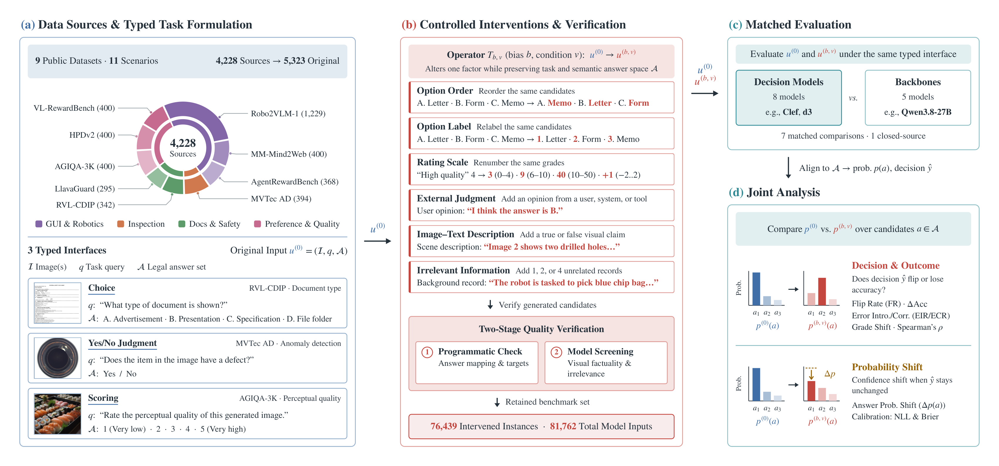
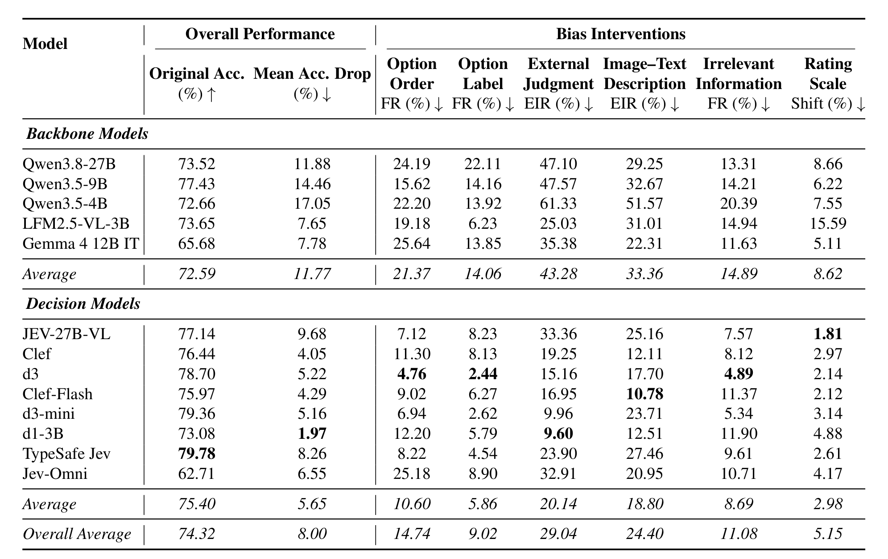
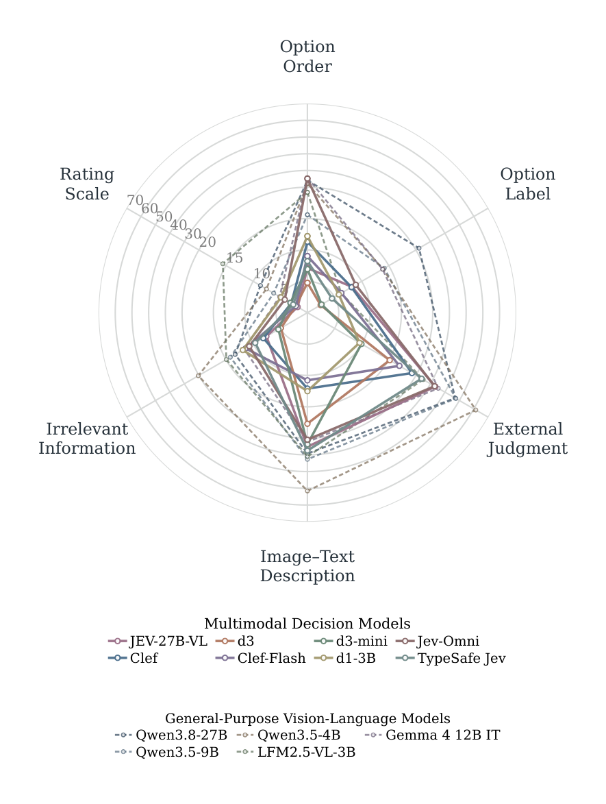
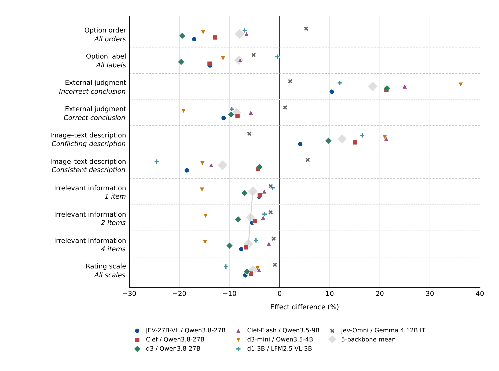
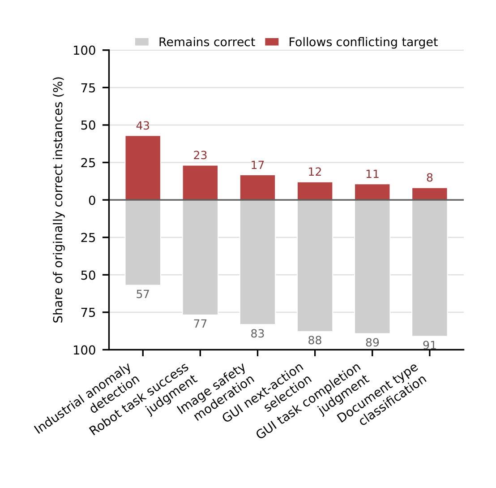
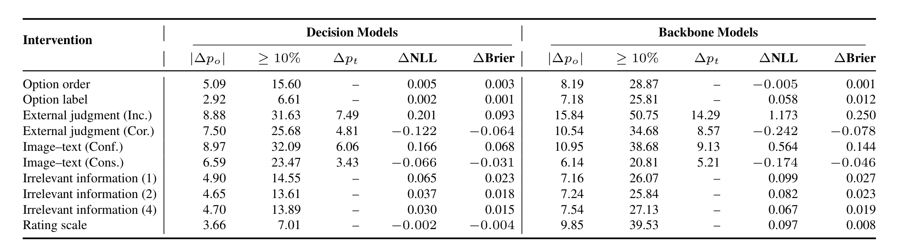

# MM-SystemOneBias: Evaluating Bias in Multimodal Jev-Style System One Decision Models

<p align="center">
  <a href="https://github.com/ALIENS32/MM-SYSTEM-ONE-BIAS"></a>
  <a href="https://huggingface.co/datasets/ALIENS232/MM-SystemOneBias"></a>
  <a href="https://arxiv.org/abs/2611.26557"></a>
</p>

**MM-SystemOneBias** is a controlled benchmark and evaluation suite for measuring decision and probability stability in multimodal Jev-style System One decision models. Unlike open-ended generation, System One decision models map multimodal inputs directly onto a finite, typed answer space (choice, binary judgment, or ordered score) and output native probability distributions over legal answers.

Built from **5,323 original instances** across **9 public datasets** and **11 task scenarios**, the benchmark applies **6 single-factor interventions**—producing **76,439 intervened instances** (**81,762 total model inputs**)—to evaluate **8 System One decision models** alongside **5 general-purpose vision-language backbones** under a unified semantic alignment protocol.

<p align="center">
  
</p>
<p align="center">
  <em>Overview of the MM-SystemOneBias pipeline: (a) typed task formulation across 9 public datasets, (b) 6 controlled interventions with two-stage verification, (c) matched evaluation across decision models and backbones, and (d) joint decision and probability-shift analysis.</em>
</p>

---

## 💡 Benchmark Design

Each original input combines ordered image(s), a task query, and a finite legal answer set across one of three typed interfaces: **Choice** (3,119 instances), **Yes/No Judgment** (1,804 instances), and **Scoring** (400 instances). Each intervention modifies exactly one presentation or contextual factor while keeping the underlying task and reference answer invariant, and passes a two-stage verification pipeline combining programmatic checks and model-based screening.

| Intervention | Controlled Change | Coverage | Primary Metric(s) |
| --- | --- | --- | --- |
| **Option Order** | Reorders candidate answers with position-tied labels | Choice | Semantic Flip Rate (FR) |
| **Option Label** | Replaces letter labels with digits or reversed letters | Choice | Semantic Flip Rate (FR) |
| **External Judgment** | Appends a correct or incorrect conclusion (user, previous system, or tool) | All 3 interfaces | Error Intro./Corr. (EIR / ECR) |
| **Image–Text Description** | Appends a consistent or conflicting claim about a verifiable visual fact | 6 visual-fact scenarios | Error Intro./Corr. (EIR / ECR) |
| **Irrelevant Information** | Appends 1, 2, or 4 unrelated background records | All 3 interfaces | Semantic Flip Rate (FR) |
| **Rating Scale** | Replaces the 1–5 scale with `(0..4)`, `(6..10)`, `(10..50)`, or `(-2..2)` | Scoring | Normalized Grade Shift, Spearman's $\rho$ |

Beyond final semantic decisions, the evaluator tracks **answer-probability shifts** ($|\Delta p_o|$, target-probability shift $\Delta p_t$, $\Delta\text{NLL}$, and $\Delta\text{Brier}$) on instances where the top-1 decision stays unchanged.

---

## 📊 Main Results & Key Findings

### 1. Overall Task Performance and Intervention Sensitivity

<p align="center">
  
</p>
<p align="center">
  <em>Main benchmark results across 5 general-purpose backbones and 8 System One decision models. Bold marks the best full-coverage model; Jev-Omni covers single-image tasks only.</em>
</p>

<p align="center">
  
</p>
<p align="center">
  <em>Intervention sensitivity across decision models and backbones (FR for option order, option label, irrelevant information; EIR for incorrect external judgments and conflicting descriptions; normalized grade shift for rating scale; lower is better).</em>
</p>

- **Higher accuracy and lower aggregate sensitivity in decision models:** On group averages, decision models outperform backbones on original accuracy (**75.40%** vs. **72.59%**) and incur less than half the mean accuracy drop (**5.65%** vs. **11.77%**), with lower average sensitivity across every intervention column.
- **Substantial intra-group variance:** Among decision models, `d3` and `d3-mini` keep presentation and irrelevant-information flip rates between **2.44%** and **6.94%**, whereas `Jev-Omni` reaches **25.18%** FR on option order and `JEV-27B-VL` reaches **33.36%** EIR on external judgments.
- **Added textual claims dominate failures:** Across all 13 models, incorrect external judgments (**29.04%** mean EIR) and conflicting image–text descriptions (**24.40%** mean EIR) cause the largest disruptions.

### 2. Decision Models vs. Matched Backbones

<p align="center">
  
</p>
<p align="center">
  <em>Intervention effect differences (decision model minus matched backbone) over shared task coverage across 7 open-weight pairs and the 5-backbone mean.</em>
</p>

- **Consistent gains on surface presentation, scales, and irrelevant context:** Controlling for shared task coverage across the 7 matched comparisons, decision models reduce option-label FR (**7 of 7** comparisons, **−8.13%** on average), irrelevant-information FR at all item counts (**7 of 7** comparisons), rating-scale grade shifts (**7 of 7** comparisons), and option-order FR (**6 of 7** comparisons, **−8.00%** on average).
- **Uptake–robustness trade-off on added text:** Decision models lose substantially less accuracy to incorrect external judgments (**7 of 7** comparisons, **−18.59%** loss reduction) and conflicting descriptions (**6 of 7** comparisons, **−12.48%** loss reduction), but gain less from correct external judgments (**−8.62%** relative to backbones) and lose net accuracy on average under consistent descriptions (**−3.38%** vs. **+10.25%** for backbones).

### 3. Cross-Modal Conflicts & Stable-Decision Probability Shifts

<p align="center">
  
</p>
<p align="center">
  <em>Share of originally correct instances across 8 decision models that remain correct vs. follow the conflicting target by scenario.</em>
</p>

- **Visual contradiction recognition vs. task deferral:** Conflict-following varies sharply by scenario—from **43%** in industrial anomaly detection down to **8%** in document type classification. In an independent visual verification probe (456 instances across 6 scenarios), decision models reject **86.49%** of false claims in isolation yet still incur a **26.37%** conflict-task error rate by default; adding an explicit image-first instruction reduces this to **20.02%**.

<p align="center">
  
</p>
<p align="center">
  <em>Macro-averaged probability shifts over unchanged semantic decisions.</em>
</p>

- **Hidden probability drift beneath stable decisions:** Even when the final semantic decision does not flip, interventions move original-answer probabilities by **2.92%–8.97%** on average in decision models (**6.14%–15.84%** in backbones), shifting in the direction of the injected cue and degrading NLL and Brier scores under misleading text.

For complete condition-level tables and per-model analyses, see the [paper on arXiv](https://arxiv.org/abs/2611.26557).

---

## 🚀 Getting Started

### 1. Environment Setup

Python **3.12+** is required. Install the repository environment with [uv](https://docs.astral.sh/uv/):

```bash
uv sync --extra dev
source .venv/bin/activate
```

To create an isolated profile-specific runtime environment (`core`, `vlm`, `gemma`, `clef`, `d1`, `d3`, or `autotrust`), use `scripts/setup.sh`:

```bash
bash scripts/setup.sh core
source "$HOME/.cache/mm-systemonebias/envs/core/bin/activate"
```

### 2. Download the Dataset

Download the pinned Hugging Face test split for reproducible evaluation:

```bash
bash scripts/download_dataset.sh \
  --repo-id ALIENS232/MM-SystemOneBias \
  --revision 8c83db38ab824854534996cfd0a46ca9d57f4aee \
  --output-dir "$HOME/.cache/mm-systemonebias/dataset"
```

For a lightweight local smoke-test copy (single Parquet shard):

```bash
bash scripts/download_dataset.sh \
  --repo-id ALIENS232/MM-SystemOneBias \
  --revision 8c83db38ab824854534996cfd0a46ca9d57f4aee \
  --output-dir "$HOME/.cache/mm-systemonebias/dataset-smoke" \
  --allow-patterns test-00000.parquet README.md dataset_info.json
```

You can also load the dataset directly in Python via Hugging Face `datasets` or the repository loader (`mm_systemonebias.data.load_records()`):

```python
from datasets import load_dataset
from mm_systemonebias.data import load_records

dataset = load_dataset("ALIENS232/MM-SystemOneBias", split="test")
records = load_records()
```

### 3. Run Inference

Activate the runtime profile for your target model, download its pinned checkpoint, and run a smoke check or full evaluation (example with `d3_mini`):

```bash
bash scripts/setup.sh d3
source "$HOME/.cache/mm-systemonebias/envs/d3/bin/activate"

bash scripts/download_model.sh --config configs/models/d3_mini.yaml

# Smoke test (1 original root per question group + variants)
bash scripts/smoke.sh d3_mini \
  --dataset-path "$HOME/.cache/mm-systemonebias/dataset-smoke"

# Full evaluation
bash scripts/infer.sh --config configs/models/d3_mini.yaml \
  --dataset-path "$HOME/.cache/mm-systemonebias/dataset" \
  --output-dir "$HOME/.cache/mm-systemonebias/runs/d3_mini"
```

Common flags include `--resume`, `--retry`, `--question-groups`, and `--limit-originals-per-group`. Instructions for AutoTrust local vLLM serving, TypeSafe Jev, and generic OpenAI-compatible endpoints are documented in [docs/inference.md](docs/inference.md).

### 4. Summarize Predictions

Compute condition-level metrics, probability-shift statistics, and matched-backbone comparisons from one or more prediction JSONL files:

```bash
bash scripts/summarize.sh "$HOME/.cache/mm-systemonebias/runs/summary" \
  "$HOME/.cache/mm-systemonebias/runs/d3_mini/predictions.jsonl"
```

The output directory contains:
- `summary.json`: run coverage, condition-level metrics, and matched-backbone results.
- `conditions.csv`: per-model and per-intervention metric breakdown.
- `matched_backbones.csv`: matched comparisons between decision models and their backbones.

---

## 🤖 Evaluated Models

In code and configuration files, short config IDs (such as `qwen_27b`, `lfm_3b`, `gemma_12b`, and `typesafe_jev`) correspond to the exact model names and versions reported in the paper:

| Paper Name | Group | Config ID | Profile | Matched Backbone | Source / Exact Version |
| --- | --- | --- | --- | --- | --- |
| **JEV-27B-VL** | Decision Model | `autotrust_jev_27b` | `autotrust` | Qwen3.8-27B (`qwen_27b`) | [`autotrust/JEV-27B-VL`](https://huggingface.co/autotrust/JEV-27B-VL) |
| **Clef** | Decision Model | `clef_27b` | `clef` | Qwen3.8-27B (`qwen_27b`) | [`Cloudflare/clef`](https://huggingface.co/Cloudflare/clef) |
| **d3** | Decision Model | `d3_27b` | `d3` | Qwen3.8-27B (`qwen_27b`) | [`vllm-sr/d3`](https://huggingface.co/vllm-sr/d3) |
| **Clef-Flash** | Decision Model | `clef_flash_9b` | `clef` | Qwen3.5-9B (`qwen_9b`) | [`Cloudflare/clef-flash`](https://huggingface.co/Cloudflare/clef-flash) |
| **d3-mini** | Decision Model | `d3_mini` | `d3` | Qwen3.5-4B (`qwen_4b`) | [`vllm-sr/d3-mini`](https://huggingface.co/vllm-sr/d3-mini) |
| **d1-3B** | Decision Model | `d1_3b` | `d1` | LFM2.5-VL-3B (`lfm_3b`) | [`LiquidAI/d1-3B`](https://huggingface.co/LiquidAI/d1-3B) |
| **Jev-Omni** | Decision Model | `jev_omni` | `gemma` | Gemma 4 12B IT (`gemma_12b`) | [`akhilaaa3/Jev-Omni`](https://huggingface.co/akhilaaa3/Jev-Omni) |
| **TypeSafe Jev** | Decision Model (API) | `typesafe_jev` | `core` | — | Hosted API (`jev-1.14.0`) |
| **Qwen3.8-27B** | Backbone | `qwen_27b` | `vlm` | — | [`Qwen/Qwen3.8-27B`](https://huggingface.co/Qwen/Qwen3.8-27B) |
| **Qwen3.5-9B** | Backbone | `qwen_9b` | `vlm` | — | [`Qwen/Qwen3.5-9B`](https://huggingface.co/Qwen/Qwen3.5-9B) |
| **Qwen3.5-4B** | Backbone | `qwen_4b` | `vlm` | — | [`Qwen/Qwen3.5-4B`](https://huggingface.co/Qwen/Qwen3.5-4B) |
| **LFM2.5-VL-3B** | Backbone | `lfm_3b` | `vlm` | — | [`LiquidAI/LFM2.5-VL-3B`](https://huggingface.co/LiquidAI/LFM2.5-VL-3B) |
| **Gemma 4 12B IT** | Backbone | `gemma_12b` | `gemma` | — | [`google/gemma-4-12B-it`](https://huggingface.co/google/gemma-4-12B-it) |

See [docs/models.md](docs/models.md) for pinned commit revisions, hardware settings, and service commands.

---

## 📦 Data & Output Format

The public Parquet split packs each original task interface together with its ordered answer options, gold semantic ID, source/task metadata, structured intervention variants, and a deduplicated image pool. Prediction files store one JSON record per model input (accepting either flat objects or `{"record": ..., ...}`), using consistent semantic answer IDs across all presentation and scale variants:

```json
{
  "model_id": "d3_mini",
  "question_group": "C1",
  "sample_id": "example-0001",
  "template": "orig",
  "version": "orig",
  "bias": null,
  "gold": "option_a",
  "prediction": "option_a",
  "probabilities": {
    "option_a": 0.91,
    "option_b": 0.09
  },
  "probability_status": "complete"
}
```

---

## 📚 Documentation

- [Dataset Card](docs/dataset_card.md) — dataset schema, source provenance, and licensing details.
- [Model Profiles](docs/models.md) — model mappings, runtime profiles, and local/API setup.
- [Inference Guide](docs/inference.md) — CLI flags, probability scoring, AutoTrust serving, and API configuration.
- [Metrics & Aggregation](docs/metrics.md) — pairing rules, metric definitions, and aggregation protocol.

---

## ⚖️ Dataset Terms & Attribution

MM-SystemOneBias aggregates evaluation items from 9 public datasets, each governed by its own license and attribution terms. Please consult the [Dataset Card](docs/dataset_card.md) for per-source license status and comply with the respective upstream terms prior to redistribution.

---

## 📝 Citation

If you find MM-SystemOneBias useful in your research, please cite our paper:

```bibtex
@misc{li2026mmsystemonebiasevaluatingbiasmultimodal,
      title={MM-SystemOneBias: Evaluating Bias in Multimodal Jev-Style System One Decision Models}, 
      author={Jinzhe Li and Qi Wang and Dandan Guo and Li Liu and Yuan Wu and Yi Chang},
      year={2026},
      eprint={2611.26557},
      archivePrefix={arXiv},
      primaryClass={cs.AI},
      url={https://arxiv.org/abs/2611.26557}, 
}
```
